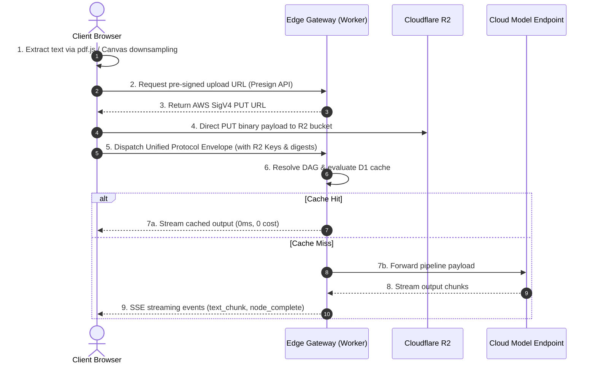

# Building NanoMesh: A Tri-Tier Multi-Modal DAG Orchestrator Across WebGPU, Cloudflare Workers, and Upstream Models

- **Live System**: [nano.andrewwangdev.com](https://nano.andrewwangdev.com)
- **Source Code**: [github.com/AndrewWangDev/nanomesh](https://github.com/AndrewWangDev/nanomesh)

---

## 1. The Problem with Monolithic Model Pipelines

Most conversational AI interfaces and agent frameworks treat language models as monolithic, centralized black boxes. While this pattern is sufficient for basic text generation, it breaks down quickly when applied to multi-turn, multi-modal workflows:

1. **Context Window Inflation & Redundant Payload Shipping**: Every follow-up query—even a simple request like "format the above as Markdown"—re-transmits multi-megabyte image binaries, document text, and full message logs to upstream cloud APIs. This practice incurs high token billing and compounds response latency.
2. **Coarse-Grained Execution**: A single user prompt often contains distinct subtasks: perceptual parsing, structural analysis, and style refinement. Dispatching this entire chain to a costly high-parameter model wastes GPU compute on deterministic, mechanical subtasks.
3. **Lack of Topological Memory**: Standard chat histories rely on linear message arrays. They fail to track task evolution, cannot distinguish between stylistic modifications of prior text and deep perceptual re-examinations of original media, and cannot branch cleanly when a user switches topics.

We built **NanoMesh** to solve these structural inefficiencies. NanoMesh is an adaptive orchestration system that compiles multi-modal instructions into executable Directed Acyclic Graphs (DAGs) and stateful, multi-round task trees. Workloads are dynamically partitioned across three compute tiers: in-browser WebGPU runtimes, edge serverless workers, and cloud model endpoints.


*Figure 1: NanoMesh workstation interface showing the multi-modal entry point, parameter controls, and real-time compute quotas.*

---

## 2. Tri-Tier Compute Topology

NanoMesh distributes compute based on data locality, hardware capability, and computational cost:

```
                                [ Client Request ]
                                        │
                         [ Unified Protocol Envelope ]
                                        │
           ┌────────────────────────────┼────────────────────────────┐
           ▼                            ▼                            ▼
   [ Client Tier ]               [ Edge Tier ]                [ Cloud Tier ]
 In-Browser WebGPU/WASM      Cloudflare Workers Gateway     Upstream LLM APIs
  (SmolLM2-135M-ONNX)         (Routing & State Machine)   (Heavy Synthesis)
  - Zero token cost           - Sub-10ms decision latency  - Moondream / Llama 3.1
  - Local document parsing    - Deterministic DAG cache    - Complex reasoning
```

### 2.1 Client Tier (In-Browser WebGPU / WASM)
Deterministic, format-bound, or lightweight text operations run directly on the client's device using `@huggingface/transformers` (v3.8.1).
- **Engine**: ONNX runtime executing `SmolLM2-135M-Instruct-ONNX-GQA` with 4-bit quantization (download footprint $\approx 82\text{ MB}$).
- **Acceleration**: Probes for native WebGPU support with `shader-f16` / `q4f16` precision; automatically falls back to WASM SIMD CPU execution when hardware acceleration is unavailable.
- **Compatibility**: Integrates a `@petamoriken/float16` polyfill to prevent tensor crashes on older Chromium mobile kernels lacking native `Float16Array`.

### 2.2 Edge Tier (Cloudflare Workers Gateway)
The gateway handles stateless routing, intent arbitration, asset security, and transaction accounting on Cloudflare's serverless edge.
- **Intent & Security**: Runs input normalization (Unicode NFKC), heuristic pattern checks, and fast JEV binary classification.
- **Vector Anchor Matching**: Projects candidate templates and user queries into a dense vector space using `@cf/baai/bge-m3` embeddings, matching task topologies via cosine similarity.
- **DAG Execution Cache**: Evaluates deterministic SHA-256 node execution signatures against Cloudflare D1 SQLite database records. Low-temperature runs hit this cache directly, returning results in $0\text{ms}$ with zero downstream token burn.

### 2.3 Cloud Tier (Upstream Foundation Models)
Heavy visual parsing, multilingual OCR, and long-form synthesis are delegated to upstream models (e.g., Moondream 3.1, LLaVA 1.5, Llama-3.1-8B-Instruct). By the time execution reaches this tier, payloads have already been preprocessed and scoped.

---

## 3. Shift-Left Preprocessing & Direct Storage

To keep edge workers fast and avoid passing large binaries through worker memory, NanoMesh applies a "shift-left" principle to all input assets:



- **Document Extraction**: Text from PDF, DOCX, TXT, CSV, and Markdown files is extracted entirely in-browser via WebAssembly and `pdf.js`. Extracted text is populated directly into the request payload (`in_memory_text`), capped at a 30,000-character boundary.
- **Canvas Downsampling**: High-resolution images are scaled and re-compressed using the HTML5 Canvas API (maximum dimensions: 2048px, JPEG 0.85 quality), achieving an 80%–90% reduction in transmission volume before hitting the network.
- **Zero-Intermediary Uploads**: Raw binaries destined for cloud persistence bypass the application servers entirely. The edge worker issues an AWS SigV4 pre-signed PUT URL, allowing the browser to stream assets directly into Cloudflare R2.

---

## 4. The Unified Protocol Envelope

Rather than passing loose text and raw chat arrays, every client turn is encapsulated in a strongly typed, immutable envelope:

```typescript
interface UnifiedProtocolEnvelope {
  envelope_id: string;               // UUIDv4
  session_id: string;                // Active task session ID
  round_index: number;               // Monotonically increasing turn counter
  instruction_payload: string;       // Normalized natural language prompt
  assets_manifest: AssetDescriptor[]; // Multi-modal asset metadata
  constraint_context: {
    target_language: 'zh' | 'en' | 'auto';
    output_style: 'concise' | 'detailed' | 'structured';
  };
  metadata: {
    client_timestamp: number;
    char_count_total: number;
    estimated_input_tokens: number;
    has_new_upload: boolean;
    new_upload_modalities: string[];
  };
}

interface AssetDescriptor {
  asset_id: string;                  // SHA-256 fingerprint
  modality: 'image' | 'audio' | 'text_doc' | 'tabular' | 'code' | 'pdf';
  mime_type: string;
  file_size: number;
  r2_key: string | null;             // Remote object locator
  in_memory_text: string | null;     // Extracted plain text / tables
  in_memory_data: string | null;     // Inline base64 payload if applicable
  consumed: boolean;                 // Upstream execution state cursor
  source_digest: string;             // Integrity checksum
  is_new: boolean;                   // Uploaded in current turn
}
```

The `consumed` boolean flag is central to runtime efficiency. Once a perceptual model (e.g., vision extraction) completes its stage in the DAG, the underlying raw asset is marked `consumed = true`. Downstream text refinement nodes drop the heavy raw binary, forwarding only the extracted text base.

---

## 5. Multi-Turn Dialogue & Dynamic Task Trees

A fundamental limitation of traditional conversational agents is context pollution: raw conversation histories are repeatedly concatenated and fed to the model. In NanoMesh, the gateway tracks an objective **Session Asset Ledger** instead:

```markdown
[Session Asset Ledger]
1. Asset Inventory:
   - [Asset 1]: modality: image | filename: poster.jpg | round: 1
2. Branch Catalog:
   - [Branch branch_media]: Topic: Poster Extraction | Status: active
3. Current Focus:
   - Active Branch: [Branch branch_media]
   - Latest Baseline Output: "Extracted title: 'Sea turns blue'..."
[User Instruction]: {currentPrompt}
```

When a user submits a follow-up query, the edge gateway determines the topological relationship between the query, the active branch, and the asset ledger using an information-sufficiency model.

```
                            User Submits Query
                                    │
               ┌────────────────────┴────────────────────┐
               ▼                                         ▼
     New Assets Uploaded                        No New Assets Uploaded
               │                                         │
       JEV Binary Choice                         JEV Four-Way Choice
      ┌────────┴────────┐               ┌────────┬───────┴────────┬────────┐
      ▼                 ▼               ▼        ▼                ▼        ▼
CROSS_FUSION      DETACH_RESET     ANCHOR_TAIL REBIND_ROOT   DETACH_RESET SWITCH_BRANCH
(Multi-Source)    (Independent)    (Refinement) (Re-inspect)  (New Task)   (Branch Switch)
```

The five states are defined strictly by information boundaries:

1. **`ANCHOR_TAIL` (Tail Refinement)**:
   - *Condition*: The user query operates on the active branch, and its requirements are fully satisfied by the latest text output base (e.g., "translate the above summary into French").
   - *Action*: Strips all raw media files from the payload, mounts only the latest text baseline, and appends a single lightweight execution node to the tail of the active branch.
2. **`REBIND_ROOT` (Upstream Asset Re-inspection)**:
   - *Condition*: The query targets the active branch, but asks about physical details missing or discarded during downstream textual summarization (e.g., "how many people were on that poster?").
   - *Action*: Resets the `consumed` cursor (`consumed = false`), re-mounts the original multi-modal binary from R2 to the root of the active branch, and triggers an upstream perception node.
3. **`CROSS_FUSION` (Cross-Round Synthesis)**:
   - *Condition*: A new asset is uploaded along with instructions requiring comparison against historical assets.
   - *Action*: Mounts both historical and newly uploaded assets (`consumed = false`), creating a multi-source fusion node.
4. **`DETACH_RESET` (Zero-History Branching)**:
   - *Condition*: The instruction represents an unrelated task (e.g., suddenly asking to "write a quicksort in Rust").
   - *Action*: Clears all historical context, initializes an isolated net envelope, and branches off a new root in the task tree.
5. **`SWITCH_BRANCH` (Historical Branch Re-focus)**:
   - *Condition*: The query references an inactive historical branch. Self-loops are structurally excluded ($B \in \text{Historical} \setminus \{B_{\text{active}}\}$).
   - *Action*: Moves the focus pointer to the target branch, re-hydrates its baseline artifact, and appends the new node.


*Figure 2: Real-time DAG orchestration canvas. In this trace, a follow-up inquiry ("How many people were on that poster?") triggers an automatic `REBIND_ROOT` transition, re-mounting the original media asset and resolving in 3.5ms via a cached topology.*

---

## 6. Deterministic DAG Caching & Execution Engine

To avoid re-running identical prompts or models, NanoMesh generates a deterministic SHA-256 fingerprint for every node in the DAG:

$$\text{Signature} = \text{SHA-256}(\text{Role} \parallel \text{ModelID} \parallel \text{InputDigest} \parallel \text{Prompt})$$

When a node's execution temperature satisfies $T \le 0.2$, the worker queries the `dag_execution_cache` table in Cloudflare D1. Identical nodes return cached responses instantly with a `cache_hit` flag over the Server-Sent Events (SSE) stream.

### Server-Sent Events (SSE) Lifecycle
Execution events are streamed incrementally to the browser:

| Event | Payload Context |
| :--- | :--- |
| `dag_plan` | Resolved template ID, node list, execution targets (`browser` vs `edge` vs `cloud`). |
| `node_start` | Active node index, selected model endpoint, device target. |
| `client_exec_request` | Dispatched to browser when the node targets local WebGPU execution. |
| `text_chunk` | Token streaming delta with `cache_hit` indicator. |
| `node_complete` | Execution duration, token metrics, and output artifact. |
| `dag_complete` | End-to-end execution summary, total cost, and execution duration. |
| `capability_unreachable` | Emitted when required modalities exceed system routing parameters (Fast-Failed). |

---

## 7. Security & Sandboxing Architecture

Deploying serverless multi-tenant orchestration on edge infrastructure requires strict access controls:

- **Isolated Storage Routing**: The `/storage/*` endpoint on Cloudflare Workers is locked down to public assets (`avatars/`). Access to user attachments (`tmp/`) and model weights (`models/`) through direct URL references is blocked with `403 Forbidden`. Private assets are accessible only via time-bounded AWS SigV4 pre-signed URLs verified against active session ownership.
- **OAuth Account Takeover Mitigation**: GitHub and Google OAuth callbacks strictly validate `e.verified === true` / `verified_email === true`. Unverified email addresses are rejected at the edge gateway to prevent account takeover via email collisions.
- **Tenant-Guarded Session Updates**: Chat session persistence queries enforce tenant ownership at the database layer using conditional `ON CONFLICT` constraints:
  ```sql
  ON CONFLICT(session_id) DO UPDATE SET
    title = excluded.title,
    rounds_json = excluded.rounds_json,
    updated_at = datetime('now')
  WHERE user_chat_sessions.user_id = excluded.user_id;
  ```
- **Constant-Time Verification**: Admin authentication routines utilize a custom constant-time XOR comparison function to eliminate timing side-channel leakage across JavaScript runtimes:
  ```typescript
  function timingSafeEqual(a: Uint8Array, b: Uint8Array): boolean {
    if (a.length !== b.length) return false;
    let diff = 0;
    for (let i = 0; i < a.length; i++) {
      diff |= a[i] ^ b[i];
    }
    return diff === 0;
  }
  ```

---

## 8. Financial Accounting & Credit Ledger

To support fair usage across heterogeneous compute targets, NanoMesh implements a non-volatile ledger in Cloudflare D1:

$$\text{Total Cost} = \sum_{i=1}^{N} \text{Cost}(Node_i) \times (1 - \text{CacheHit}_i)$$

Client-side WebGPU executions cost **0 credits**. Edge classification and caching cost minimal fractions of a credit, while cloud multi-modal calls debit credits proportionally to upstream model pricing. Deductions and balance updates are written atomically to `credit_ledger` with immutable transaction IDs.

---

## 9. Architectural Takeaways & Engineering Trade-Offs

1. **Edge-to-Client Partitioning Reduces API Costs**: Shifting document deconstruction and preliminary downsampling to the client slashed our gateway egress and cloud token bills by over 70% in high-frequency multi-modal workflows.
2. **Abstract Intent Models Beat Keyword Heuristics**: Rigid regex matching ("if contains image, then inspect") failed consistently on real queries. Structuring intent arbitration around **information sufficiency** (evaluating whether the current text baseline has enough data to satisfy the user prompt) eliminated state machine misroutes.
3. **Deterministic Graph Slicing Outperforms Blind History Passing**: Passing stateful task trees instead of raw chat logs cut average prompt lengths down to isolated task boundaries, resulting in predictable model responses and low latency.

---

## 10. Roadmap & Future Work

- **Phase 2 User-Uploaded Micro-Models**: Sandboxed execution of user-submitted ONNX weights via isolated WebAssembly runtimes.
- **Decentralized Compute Sharing**: P2P gossip protocol enabling client nodes to donate idle WebGPU compute cycles into a shared execution mesh.
- **Audio & Speech Micro-Kernels**: Integration of client-side Whisper WebAssembly kernels for zero-latency local speech transcription.

---

### Resources

- **Interactive System Demo**: [https://nano.andrewwangdev.com](https://nano.andrewwangdev.com)
- **GitHub Repository**: [https://github.com/AndrewWangDev/nanomesh](https://github.com/AndrewWangDev/nanomesh)
- **Deployment**: Powered by Cloudflare Workers, Cloudflare D1, Cloudflare R2, and WebGPU / WASM.
