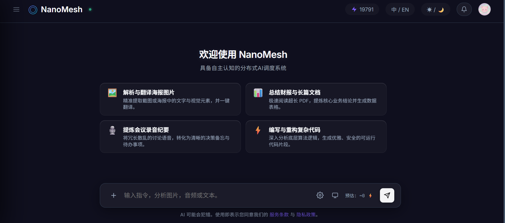
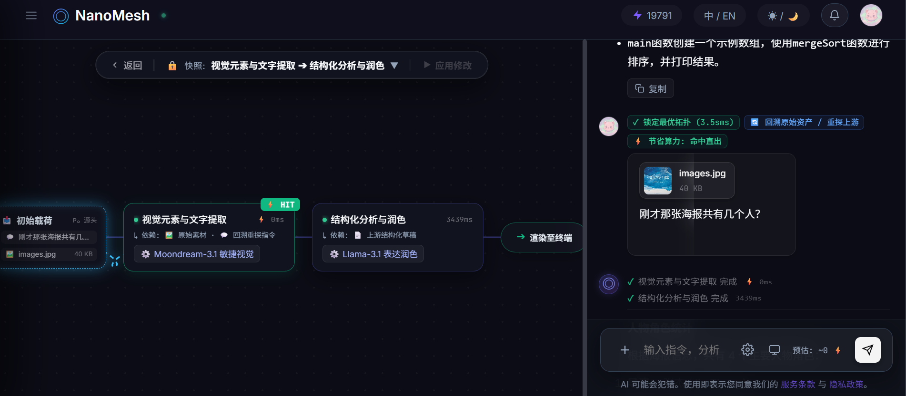

# NanoMesh

> 分布式 AI 调度系统与异构微模型基础设施网络。  
> Distributed AI Orchestration System and Heterogeneous Micro-Model Infrastructure.

[](https://workers.cloudflare.com/)
[](https://developer.mozilla.org/en-US/docs/Web/API/WebGPU_API)
[](https://www.typescriptlang.org/)
[](./LICENSE)

[English](./README.md) | [简体中文](./README_zh.md)

---

### 1. 项目概述

NanoMesh 是一套针对异构微模型与多模态任务调度的自适应分布式编排系统。系统将用户的多模态指令编译为可编辑的有向无环图（DAG），并在多轮交互中自适应维护有记忆的任务演化树。

系统构建了三层算力拓扑网络：
- **端侧轻节点**：运行于浏览器内的 WebGPU / WebAssembly 微模型推理；
- **边缘中节点**：部署于 Cloudflare Workers 的无服务器分布式网关与状态机；
- **云端重节点**：接入上游大语言模型 API 执行高复杂度生成任务。

```
                                  [ 用户交互指令 ]
                                         │
                                  [ 统一协议信封 ]
                                         │
           ┌─────────────────────────────┼─────────────────────────────┐
           ▼                             ▼                             ▼
     [ 端侧轻节点 ]                [ 边缘中节点 ]                [ 云端重节点 ]
 浏览器 WebGPU/Wasm 本地推理     Cloudflare Workers 网关调度     上游大模型 API 直答
   (SmolLM2-135M-ONNX)           (安全审计与状态机流转)         (重度逻辑综合交付)
```

#### 1.1 系统界面与实时 DAG 编排画布

<p align="center">
  
  <br />
  <em>图 1.1: NanoMesh 交互控制台与多模态工作区</em>
</p>

<p align="center">
  
  <br />
  <em>图 1.2: 实时 DAG 编排画布与多轮意图溯源状态机</em>
</p>

---

### 2. 架构设计与核心机制

#### 2.1 三层算力拓扑

1. **轻节点（浏览器侧端推理）**：基于 `@huggingface/transformers`，直接调用客户端 GPU（WebGPU）或 CPU（WASM SIMD）运行，不消耗云端算力，保障基础处理时延与隐私隔离。
2. **中节点（边缘分布式计算）**：基于 Cloudflare Workers 执行安全审计、向量嵌入匹配、模板评分及 DAG 状态机调度。
3. **重节点（云端模型直答）**：处理需要大参数量支撑的复杂代码生成、多模态综合推理等重任务。

#### 2.2 计算左移处理管线

为降低传输等待时间与网关计算压力，预处理全面左移至客户端执行：
- **文档就地解析**：浏览器端使用 WebAssembly / `pdf.js` 直接解析 PDF、DOCX、TXT、CSV、Markdown 等文档，提取为 `in_memory_text` 纯文本或表格流。
- **图像自适应降采样**：客户端通过 HTML5 Canvas API 按比例缩减分辨率（最大 2048px，JPEG 0.85 质量压缩），在人眼无损前提下缩减 80%~90% 上传体积。
- **文本软限制截断**：文档提取出的文本超过 30,000 字符时，就地自动截断并给予提示。
- **直连对象存储**：对于需要持久化的多模态介质，通过网关签发 AWS SigV4 预签名临时 PUT URL，文件由浏览器直传 Cloudflare R2 存储桶。

---

### 3. 通信协议规范

#### 3.1 统一协议信封 (UnifiedProtocolEnvelope)

客户端在发起调度前，将非结构化输入封装为强类型只读信封：

```typescript
interface UnifiedProtocolEnvelope {
  envelope_id: string;             // 全局唯一信封 UUID
  session_id: string;              // 当前会话 Session ID
  round_index: number;             // 当前会话轮次序号 (从 1 递增)
  instruction_payload: string;     // 清洗后的自然语言文本提示词
  assets_manifest: AssetDescriptor[]; // 关联多模态资产清单
  constraint_context: {            // 客户端请求的环境约束上下文
    target_language: string;       // 偏好输出语言 ('zh' | 'en' | 'auto')
    output_style: string;          // 输出风格 ('concise' | 'detailed' | 'structured')
  };
  metadata: {                      // 运行时元数据
    client_timestamp: number;      // 客户端发起的毫秒时间戳
    char_count_total: number;      // 提示词字符数
    estimated_input_tokens: number;// 预估消耗 Token 量
    has_new_upload: boolean;       // 本轮是否包含新引入资产
    new_upload_modalities: string[];// 本轮新引入资产的模态列表
  };
}
```

#### 3.2 资产描述符 (AssetDescriptor)

```typescript
interface AssetDescriptor {
  asset_id: string;                // 资产唯一指纹 ID
  modality: 'image' | 'audio' | 'text_doc' | 'tabular' | 'code' | 'pdf';
  mime_type: string;               // 原始 MIME 类型
  file_size: number;               // 字节大小
  r2_key: string | null;           // R2 寻址指针（若需云端存储）
  in_memory_text: string | null;   // 就地解构提取出的纯文本 / Markdown
  in_memory_data: string | null;   // Base64 短内联数据（可选）
  consumed: boolean;               // 状态游标：是否已被 DAG 某个上游节点独占消费
  source_digest: string;           // 资产完整性哈希指纹
  is_new: boolean;                 // 是否为本轮对话新上传的资产
  filename: string;                // 文件名
}
```

*说明：若用户提交时未挂载任何附件，网关自动将提示词虚拟为文本资产挂载入资产清单，保证 DAG 模态匹配规则的一致性。*

---

### 4. 模型仲裁与路由算法

系统采用三步仲裁法确定执行拓扑：

```
[ 用户输入请求 ]
       │
       ▼
┌────────────────────────────────────────────────────────┐
│ 第一步：安全审计与硬筛选                               │
│ - 影子字符串标准化 (Unicode NFKC 压平)                 │
│ - 启发式风险模式嗅探                                   │
│ - JEV Safety 旁路二元决策 (@cf/cloudflare/clef-flash) │
│ - 基于“温饱规则”的候选模板筛选                        │
└────────────────────────────────────────────────────────┘
       │
       ▼
┌────────────────────────────────────────────────────────┐
│ 第二步：JEV 评分与胜任力解析                           │
│ - Workers AI 候选模板胜任度打分                        │
│ - Fast-Failed 边界探针判定                             │
│ - 胜任定律：输入/输出模态与岗位标签交集运算            │
│ - 岗位标签降级策略与补偿 Prompt 注入                   │
└────────────────────────────────────────────────────────┘
       │
       ▼
┌────────────────────────────────────────────────────────┐
│ 第三步：锚点向量匹配与流量整形                         │
│ - @cf/baai/bge-m3 提取多语言密集语义向量               │
│ - 与模型高频场景锚点计算余弦相似度                     │
│ - 终极量化打分公式计算（含二次方并发惩罚）             │
│ - 实例化主执行模型 (Top 1) 与备选模型池 (Top 2 & 3)    │
└────────────────────────────────────────────────────────┘
```

#### 4.1 第一步：安全审计与硬筛选

1. **影子字符串预处理**：剥离零宽字符与不可见格式控制符，执行 Unicode NFKC 标准化，压平空白与标点符号，统一转小写。
2. **启发式嗅探打标**：对恶意代码、未授权渗透、网络拒绝服务工具及凭据窃取等风险特征进行模式扫描。常规良性请求 0ms 直接放行；高危红线（如违禁暴力）直接熔断阻断。
3. **JEV Safety 旁路拦截**：仅对命中可疑特征的输入，调用 `@cf/cloudflare/clef-flash` 执行 `is_malicious: noul` 二元分类，区分实际恶意利用与良性安全防护配置。
4. **模型硬筛选**：从元数据库剔除不符合以下条件的模型：
   - 综合评分 $R_m < 1.0$；
   - 实时并发数 $> 300$ 或当前并发达到自身上限（满载）；
   - 上下文窗口容量小于当前预估所需 Token；
   - 模型状态非激活（`status !== 'active'`）；
   - 满足客户端本地推理偏好（若用户开启“不使用本地模型推理”，屏蔽 `inference_target === 'browser'`）。
5. **温饱规则（模板收敛）**：
   $$\{ \text{头节点输入模态} \} \subseteq A_{\text{用户资产}} \subseteq \{ \text{头节点输入模态} \} \cup \{ \text{尾节点输入模态} \}$$
   对于单节点 DAG（$\text{in} = 0, \text{out} = 0$），强制等价收敛：$A_{\text{用户资产}} \equiv N_{\text{输入模态}}$。

#### 4.2 第二步：JEV 评分与岗位胜任力

1. **候选模板评估**：调用 `@cf/cloudflare/clef-flash` 对满足温饱定律的候选模板进行打分评估。
2. **Fast-Failed 机制**：若最高模板匹配得分低于置信阈值（$\tau < 0.35$ 或标准分 $< 25$），直接装配 `role_unreachable` 单节点，以 0 算力消耗返回能力边界建议面板。
3. **胜任定律交集运算**：从模板提取各个岗位，对候选模型库执行交集筛选：
   - 岗位输入模态 $\subseteq$ 模型输入模态；
   - 岗位输出模态 $\subseteq$ 模型输出模态；
   - 岗位征调标签 $\subseteq$ 模型标签。
4. **标签平滑降级**：若交集为空，按“岗位-标签”预置表向下检索备选标签重新匹配，并在该节点挂载补偿 Prompt 稳定输出。

#### 4.3 第三步：锚点向量匹配与流量整形

在精选模型池内执行最终量化选拔：
1. **语义向量匹配**：调用 `@cf/baai/bge-m3` 提取提示词向量，与模型预设的高频场景锚点做批量余弦相似度计算：
   $$\text{sim} = \max_{a \in \text{Anchors}} \cos(\vec{v}_{\text{prompt}}, \vec{v}_a)$$
2. **终极量化打分公式**：
   $$S = \mu_0 + \alpha \cdot \max(0, \text{sim} - \tau) + \beta \cdot \frac{R_m}{5.0} - \gamma \cdot \left(\frac{C_{\text{active}}}{C_{\text{max}}}\right)^2$$
   - $\mu_0 = 0.25$（通才先验分；专才模型为 0.0）
   - $\alpha = 0.50$（专才权重系数）
   - $\tau = 0.65$（专才门控激活阈值）
   - $\beta = 0.25$（综合评分权重，其中 $R_m \in [1, 5]$）
   - $\gamma = 0.40$（二次方并发惩罚系数，负载接近满载时抑制分配）
3. **拓扑实例化**：评分第 1 名作为主执行模型（Primary Model）；第 2、3 名写入备选模型池（Standby Models），供前端随时热切换或网关故障转移。

---

### 5. 执行状态机与流式协议

#### 5.1 信封切片规则（不贪吃原则与提示词遮蔽）

- **首节点（$\text{in} = 0, \text{out} > 0$）**：认领模态匹配且 `consumed === false` 的资产，置位 `consumed = true`。严格遮蔽用户主提示词（`is_head_masked = true`），避免下游语义污染。
- **中间节点（$\text{in} > 0, \text{out} > 0$）**：严格仅接收所有父节点的汇总输出产物（$\sum \text{Out}_{\text{parent}}$），不触碰主信封原始介质。
- **尾节点（$\text{out} = 0$）**：接收上游汇总产物、剩余未被消费资产、用户原始提示词与环境约束，生成最终交付物。
- **单节点 DAG（$\text{in} = 0, \text{out} = 0$）**：同时接收原始资产与提示词。

#### 5.2 确定性节点指纹与缓存

各节点依据输入要素计算 SHA-256 哈希签名：
$$\text{Signature} = \text{SHA256}(\text{Role} + \text{ModelID} + \text{InputSourceDigest} + \text{InjectedPrompt})$$
在低采样温度（$T \le 0.2$）下，通过 D1 表 `dag_execution_cache` 命中产物直接返回。

#### 5.3 SSE 实时流式事件协议

| 事件名称 | 描述 |
| :--- | :--- |
| `dag_plan` | 广播征调模板元信息与 DAG 拓扑节点结构数组。 |
| `node_start` | 广播开始执行的节点序号、岗位名称、选中模型及设备目标。 |
| `client_exec_request` | 当节点调度至浏览器本地时，向前端派发本地推理指令 payload。 |
| `text_chunk` | 尾节点流式输出文本增量 Token（附带 `cache_hit` 标识）。 |
| `node_complete` | 单个节点执行完成，回传耗时、Token 统计与产物。 |
| `dag_complete` | 整个 DAG 编排图执行完毕，推送最终综合交付物。 |
| `security_blocked` | 触发安全策略拦截时推送。 |
| `capability_unreachable` | 触发能力边界不可达（Fast-Failed）时推送。 |
| `dag_error` | 发生不可恢复的执行异常时推送。 |

---

### 6. 多轮交互与动态任务树

网关不盲目透传整段历史，而是维护一份结构化的“会话事实账本”：

```markdown
【会话事实账本】
1. 资产原件介质表:
   - [资产 1]: 模态: image | 文件名: spec.png | 引入轮次: 第 1 轮
   - [资产 2]: 模态: text_doc | 文件名: api.md | 引入轮次: 第 2 轮
2. 任务树分支目录:
   - 【分支 main: 初始系统分析】 状态: 活跃分支
3. 当前活跃焦点:
   - 当前正在进行的分支: 【分支 main】
   - 当前分支最新产物基底: "系统架构定义已完成..."
[用户最新指令]: {currentPrompt}
```

JEV 依据上下文进行五状态收敛判定：

```
                            用户在聊天框发送指令
                                     │
               ┌─────────────────────┴─────────────────────┐
               ▼                                           ▼
      本轮包含新上传附件                           本轮无新上传附件
               │                                           │
         JEV 二选一判定                              JEV 四选一判定
       ┌───────┴───────┐                 ┌────────┬────────┴────────┬────────┐
       ▼               ▼                 ▼        ▼                 ▼        ▼
 CROSS_FUSION    DETACH_RESET       ANCHOR_TAIL REBIND_ROOT   DETACH_RESET SWITCH_BRANCH
 (新旧融合对比)  (独立全新任务)       (轻量修饰)  (回溯重探)    (新独立任务) (历史分支切换)
```

- **状态 A (`ANCHOR_TAIL`)**：指令属于当前活跃分支脉络，且所需事实信息完全由当前最新产物基底即可自洽满足。逻辑剥离原始大型媒体资产，以文本基底在活跃分支末端生长单步执行节点。
- **状态 B (`REBIND_ROOT`)**：指令属于当前活跃分支脉络，但所需信息未在最新产物基底中包含或在下游抽象中已丢失，仅凭文字基底无法充分解答，必须穿透回溯底层原始多模态物理介质本身。全量复位该分支原始物理资产（`consumed = false`）并装配多模态感知工作流。
- **状态 C (`CROSS_FUSION`)**：联合分析新上传资产与历史既有资产。全量重置资产消费游标（`consumed = false`）并在当前分支创建融合节点。
- **状态 D (`DETACH_RESET`)**：指令开启完全独立的新任务，与当前活跃分支及所有历史分支无信息依赖。彻底清空历史挂载，构造独立的“零历史净信封”。
- **状态 E (`SWITCH_BRANCH`)**：指令脱离当前活跃分支领域，转而依赖某一非活跃的历史分支。目标分支集合在图结构上严格排除当前分支自环（目标分支 $B \neq B_{\text{active}}$）；切换焦点指针至目标分支，若目标分支关联多模态物理介质且需要溯源，连带复位该分支原始资产。

---

### 7. 端侧 WebGPU 微模型引擎

NanoMesh 内置基于 `@huggingface/transformers` (v3.8.1) 的浏览器端微模型推理引擎：

- **选型端点**：`onnx-community/SmolLM2-135M-Instruct-ONNX-GQA`
- **模型规格**：约 1.35 亿参数；Q4 量化下载体积约 82MB。
- **硬件适配**：优先探测 WebGPU 与 `shader-f16` / `q4f16` 精度；若不支持则自动降级为 Wasm SIMD CPU 执行。
- **环境垫片**：针对部分移动端 Chromium 内核缺少原生 `Float16Array` 的问题，引入 `@petamoriken/float16` 垫片。
- **运行采样参数**：
  - `do_sample`: `true`
  - `temperature`: `0.6`
  - `top_p`: `0.9`
  - `repetition_penalty`: `1.25`
  - `max_new_tokens`: `384`
- **输出过滤**：实时过滤 `<|im_start|>`、`System:` 等模板泄露标记。

---

### 8. 安全机制、频控与配额

#### 8.1 渲染安全与响应头

- **DOMPurify 净化管道**：所有 Markdown 及模型流式输出均在 `safeRenderMarkdown()` 内通过 `DOMPurify 3.1.6` 净化。移除 `<script>`、`<iframe>`、`<object>`、`<form>` 及 `onerror`、`onload`、`onclick` 等内联属性。
- **安全响应头**：所有 API 响应强制注入 `X-Content-Type-Options: nosniff`。

#### 8.2 边缘滑动窗口令牌桶限流

基于 Cloudflare Worker Isolate 内存 Map 实现的自适应令牌桶：
- **桶容量**：3（支持短时快速重试）。
- **补充速率**：每 5 秒补充 1 个令牌（稳态等效持续约 12 请求/分钟）。
- **超频响应**：返回 HTTP 429 与 `Retry-After: N` 响应。
- **交互保护**：前端弹出自定义倒计时模态弹窗（`#rate-limit-modal`），自动保留并回填用户输入文本，倒计时结束后解除锁定。

#### 8.3 附件上传配额

- **文件个数限制**：单次最多上传 5 个文件（`MAX_FILES = 5`）。
- **总文件大小限制**：多附件总大小上限 20MB（`MAX_TOTAL_SIZE = 20MB`）。
- **单文件上传硬限制**：单文件云端上传硬限制 25MB（`MAX_CHAT_FILE_SIZE = 25MB`）。
- **算力余额保护**：用户可用余额 `credits <= 0` 时，禁止附件预签名与任务提交（HTTP 403 / 弹出充值提示）。

---

### 9. 财务与运营闭环

- **注册体验包**：新用户注册获得 100 ⚡ 初始算力包。
- **双向邀请机制**：老用户成功邀请新用户，老用户获赠 50 ⚡，新用户获得初始 100 ⚡ + 邀请奖励 50 ⚡（共 150 ⚡）。
- **账目审计体系**：D1 表 `credit_ledger` 全量记录任务扣费、注册赠予、卡密充值与网格收益流水。
- **管理控制台 (`/admin.html`)**：
  - 在线修改模型状态、并发上限与权重；
  - 批量生成、查询与作废充值卡密；
  - 向客户端派发全员或定向系统通知。

---

### 10. 快速部署

#### 10.1 环境要求

- [Node.js](https://nodejs.org/) v18+
- [Cloudflare Wrangler CLI](https://developers.cloudflare.com/workers/wrangler/)
- Cloudflare D1 数据库与 R2 存储桶

#### 10.2 环境变量配置

在项目根目录下配置 `.dev.vars`：

```env
JWT_SECRET=your-secure-jwt-secret
GITHUB_CLIENT_ID=your-github-oauth-client-id
GITHUB_CLIENT_SECRET=your-github-oauth-client-secret
GOOGLE_CLIENT_ID=your-google-oauth-client-id
GOOGLE_CLIENT_SECRET=your-google-oauth-client-secret
FRONTEND_URL=https://your-domain.com
```

配置 `wrangler.toml` 绑定信息：

```toml
name = "nanomesh"
main = "src/index.ts"
compatibility_date = "2024-09-23"

[[d1_databases]]
binding = "DB"
database_name = "nanomesh-db"
database_id = "your-database-id"

[[r2_buckets]]
binding = "R2"
bucket_name = "nanomesh-assets"

[ai]
binding = "AI"
```

#### 10.3 构建与部署

```bash
# 安装依赖
npm install

# 部署至 Cloudflare Workers
npm run deploy
```

---

### License

Distributed under the MIT License. See [LICENSE](./LICENSE) for more information.
